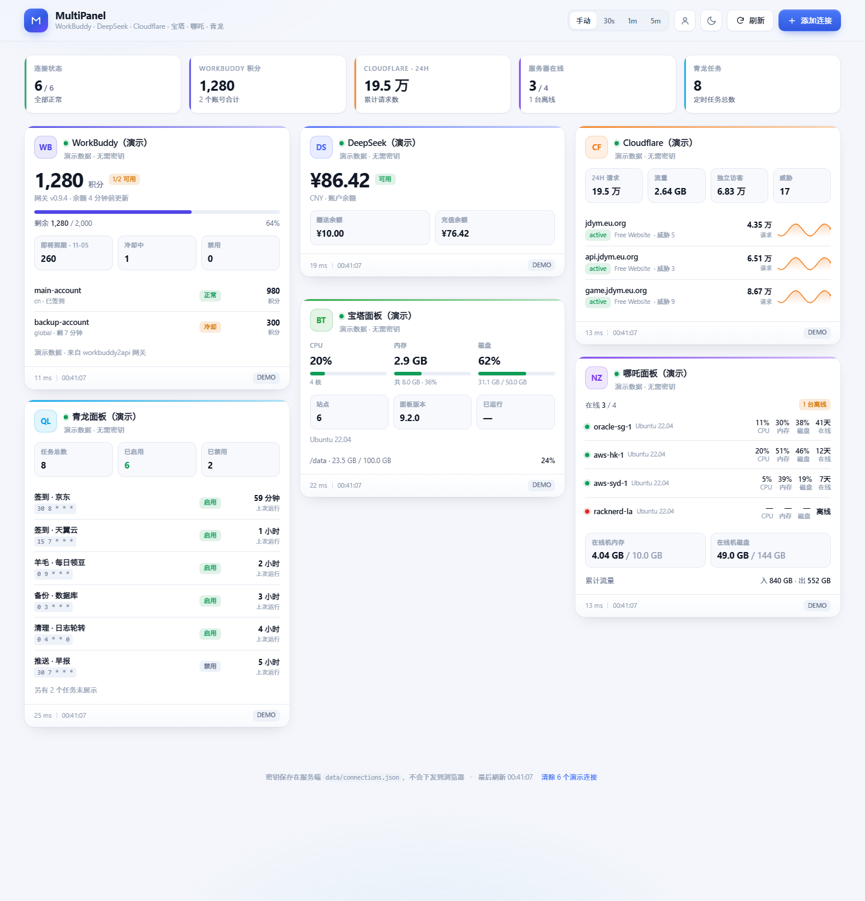

# MultiPanel · 多平台仪表盘

把散在各处的账号面板收拢到一个页面：**WorkBuddy 积分 · DeepSeek 余额 · Cloudflare 域名请求量 · 宝塔面板资源 · 哪吒面板服务器状态 · 青龙面板定时任务**。

零第三方依赖（只用 Node 内置模块），`node server.js` 就能跑，密钥只保存在本机服务端，不下发到浏览器。

## 预览



深色模式：[screenshot-dark.png](screenshot-dark.png)

---

## 1. 快速开始

**要求**：Node.js 18 及以上（推荐 20+）。项目零第三方依赖，**无需 `npm install`**。

```bash
# 1. 获取代码（也可以直接在 GitHub 点「Code → Download ZIP」解压）
git clone https://github.com/chuzzhang/multipanel-dashboard.git
cd multipanel-dashboard

# 2. 启动
node server.js          # 默认 http://127.0.0.1:8787
```

3. 浏览器打开 `http://127.0.0.1:8787`，首次进入会要求设置管理员密码；
4. 进入看板后还没有数据：点「**先看演示数据**」预览全部卡片，或点「**添加连接**」接入真实平台。

> Windows 用户也可以直接双击 `start.bat`（会自动打开浏览器并启动服务）。

### 启动参数（环境变量）

| 环境变量 | 说明 | 默认 |
| --- | --- | --- |
| `PORT` | 监听端口 | `8787` |
| `HOST` | 监听地址 | `127.0.0.1`（仅本机） |
| `ALLOW_INSECURE_TLS` | 设为 `0` 则严格校验 HTTPS 证书；默认放行自签证书（自建面板常见） | 放行 |
| `ADMIN_PASSWORD` | 首次启动时用它初始化管理员密码（已设置过则忽略） | 无 |
| `ADMIN_USERNAME` | 配合上一个变量指定用户名 | `admin` |
| `AUTH_DISABLED` | 设为 `1` 完全关闭登录校验（仅限完全可信的本机环境） | 关闭登录 |
| `PUBLIC_URL` | 面板对外访问地址（如 `https://mp.example.com`）。仅在个别环境被 CSRF 校验拦下时才需要 | 无 |

---

## 2. 管理员登录

面板默认带登录保护，第一次打开会要求设置管理员密码（至少 8 位），之后用同一个密码登录。

- **首次设置**：打开页面 → 填用户名（默认 `admin`）和两遍密码 → 进入面板。
- **会话**：登录后写入 HttpOnly Cookie，有效期 7 天，会话持久化在 `data/sessions.json`，重启服务不用重新登录。
- **改密 / 退出**：点顶栏的人像图标 → 账户弹窗。改密后其他设备上的会话会自动失效。
- **忘记密码**：删掉 `data/auth.json` 后重启服务，页面会重新回到「设置管理员密码」。
- **防爆破**：同一 IP 连续输错 8 次锁定 10 分钟，剩余次数会在提示里显示。
- **跳过登录**：`AUTH_DISABLED=1 node server.js`（不建议在公网环境用）。

密码只保存 scrypt 哈希（N=16384, r=8, p=1），不存明文；所有 `/api/*` 接口除 `health` 和登录相关外，未登录一律返回 401。

---

## 3. 各平台怎么填

### WorkBuddy
WorkBuddy 官方没有公开的积分接口，所以支持三种取数方式，默认走 **自建网关**：

#### ① workbuddy2api 网关（推荐）
指 [linguo2625469/workbuddy2api-panel](https://github.com/linguo2625469/workbuddy2api-panel)：一个把 WorkBuddy / CodeBuddy 账号包装成 OpenAI 兼容接口的自托管网关，自带账号池与积分查询。

1. 按项目 README 部署网关，默认监听 `:7863`；
2. 网关首次启动会生成 `config.json`，其中 `api_key` 就是这里要填的 key（为空表示网关不鉴权）；
3. 在「添加连接 → WorkBuddy」里选「workbuddy2api 网关」，填 `http://127.0.0.1:7863` 和 api_key，点「测试连接」。

读取逻辑与展示内容：

| 项目 | 说明 |
|---|---|
| 接口 | `GET /panel/api/overview`，404 时自动回退 `GET /status` |
| 鉴权 | `Authorization: Bearer <api_key>`，网关 api_key 为空则不带 |
| 积分 | 汇总账号池 `accounts[].credits`；`credits_total` 已知时画进度条 |
| 账号池 | 总数 / 可用 / 冷却 / 禁用（暂停），来自网关聚合字段 |
| 到期提醒 | 合并各账号 `credits_expiry_buckets`，按自然日取最早一批 |
| 账号明细 | 昵称、域（cn/global）、企业版、今日签到、冷却剩余、单号积分 |
| 余额时间 | 用 `balance_refreshed_at` 标注「x 分钟前更新」 |

趋势线仍然走本地快照：每次刷新把总积分记到 `data/workbuddy-history.json`，超过 1 小时或数值变化才追加一条。

> 该网关项目已于 2026-10-21 停止维护，上游风控可能随时变化，账号风险自担；`auths/*.json` 里存的是明文 token，别把网关暴露在公网。

#### ② 手动记账
填当前积分、总量、套餐、重置日期，进度条与趋势都在本地计算。适合没有网关、只想记个数的情况。

#### ③ 自定义 API
填一个返回 JSON 的地址（可带 Bearer Token），服务端会自动寻找 `credit / balance / point / quota / remaining` 之类的数值字段；认不出来就手写字段路径，例如 `data.credits`。

### DeepSeek
在 [platform.deepseek.com/api_keys](https://platform.deepseek.com/api_keys) 建 Key。
调用 `GET /user/balance`，显示总余额、赠送余额、充值余额、可用状态。

几个容易踩的点（适配器都已处理）：

| 情况 | 处理方式 |
| --- | --- |
| 地址填成 `https://api.deepseek.com/v1` | 自动去掉 `/v1`、`/chat/completions`、`/models` 等后缀 |
| Key 前后带空格 / 引号 / `Bearer ` | 自动清理后再发请求 |
| 401 | 透出服务端原文（含 `request_id`），并提示 Key 归属站点或中转站问题 |
| 404 | 明确提示余额接口是 `/user/balance`，OpenAI 兼容中转站通常没有余额接口 |
| 返回网页 | 提示地址被填成了控制台首页 |

走中转站时把「API 地址」改成中转站地址；多数 OpenAI 兼容中转站没有余额查询接口，此时无法读取余额。

### Cloudflare
在 [API Tokens](https://dash.cloudflare.com/profile/api-tokens) 创建 Token，权限给：

- `Zone → Zone: Read`
- `Zone → Analytics: Read`

统计口径：最近 24 小时的**请求数 / 流量 / 独立访客 / 威胁 / 缓存命中率**，按域名列出并带 24 小时迷你曲线。
数据先走 GraphQL（`httpRequests1hGroups`），失败自动回退 REST analytics dashboard。
「统计域名上限」控制一次最多详细统计多少个域名（默认 10，Token 下域名多时避免请求过慢）。

### 宝塔面板
1. 面板 →「面板设置」→「API 接口」→ 打开开关，复制 **API 密钥**；
2. 把本机公网 IP 加入 **IP 白名单**（不加会返回登录页 HTML / IP 校验失败）；
3. 地址填 `http://你的IP:8888`（带协议和端口，不要带 `/`）。若面板开了「安全入口」，地址要带上入口后缀，如 `https://ip:8888/abcd1234`。

**签名算法（易踩坑）**：宝塔 8.x / 9.x 起是

```
request_token = md5(request_time + md5(api_key))
```

而旧版是 `md5(request_time + api_key)`。本面板先试新版、失败自动重试旧版，并把成功的方案缓存下来，所以两种版本都能连；密钥不对时会明确提示「密钥校验失败」而不是笼统报错。

| 项目 | 说明 |
| --- | --- |
| 系统指标 | `POST /system?action=GetSystemTotal` → CPU、内存（`memRealUsed`）、核心数、系统、版本、运行时长（`time`） |
| 磁盘 | `POST /system?action=GetDiskInfo` → 优先用 `byte_size`（字节）换算，避免 `size` 里 `"95.8 GB"` 这类带单位字符串解析错 |
| 站点数 | `POST /data?action=getData`（`table=sites`）→ `data.length`；`/site?action=GetSiteList` 在 13.x 会返回「指定参数无效」，仅作兜底 |
| 展示 | CPU / 内存 / 磁盘三个表盘，站点数、面板版本、已运行时长，系统信息一行小字 |

> 数据请求串行鉴权后，磁盘与站点并行取，减少一次往返回路。

### 哪吒面板
面板 →「用户」→ 复制该账号的 **API Token**（管理员 Token 可看到全部服务器）。
接口按 `/api/v1/servers` → `/api/v1/server` 顺序尝试，命中的路径会缓存，后续不再多打一次 404。

**在线状态怎么来的（关键）**：哪吒 v1 的 `/api/v1/server` 返回里**没有 `online` 字段**，只有 `last_active`。
所以在线判定是「`last_active` 距今 < 90 秒」——3 个心跳周期（默认 30s）都没上报才算离线。
这也意味着：面板刚重启、或宿主机时钟偏快/偏慢时，判定可能和面板页面略有出入。

| 字段 | 来源 |
| --- | --- |
| 在线 | `last_active` 距今 < 90s（如接口显式给了 `online` 则优先用它） |
| CPU | `state.cpu` |
| 内存 | `state.mem_used` / `host.mem_total` |
| 磁盘 | `state.disk_used` / `host.disk_total` |
| 在线时长 | `state.uptime`（秒，紧凑显示为 `18天`） |
| 系统 | `host.platform` + `host.platform_version` |
| 流量 | `state.net_in_transfer` / `state.net_out_transfer` |

离线机器的 CPU/内存会显示 `—`，末尾改为「x 分钟前活跃」，避免展示过期数值。超过 6 台只显示前 6 台并提示剩余数量。

### 青龙面板
推荐在「系统设置 → 应用设置」新建应用，拿 **Client ID / Secret**（走 OpenAPI，不受登录风控影响）；
也可以只填面板账号密码走 `/api/user/login`。

**版本差异（重要）**：青龙 2.21 起取 token 从 `POST /open/auth/token`（JSON body）改成了
`GET /open/auth/token?client_id=…&client_secret=…`（查询串）。本面板会先试 GET，再试 POST，
都失败才回落到账号密码，因此新旧版本都能用。

| 项目 | 说明 |
| --- | --- |
| 鉴权 | `GET /open/auth/token?client_id&client_secret` → `{code:200,data:{token,expiration}}`；token 进程内缓存，按 expiration 提前 1 分钟失效 |
| 任务列表 | `GET /open/crons?page=1&size=200` → `{code:200,data:{data:[…],total}}` |
| 兼容旧结构 | 也支持 `data` 直接是数组（老版本/账号密码登录路径） |
| 禁用判定 | 只看 `isDisabled`；2.21 的 `status=1` 表示运行态，不能当禁用 |
| 展示 | 任务总数 / 启用 / 禁用、前 6 条任务（名称、cron 表达式、上次运行时间）；超过 6 条提示剩余数量 |

> 账号密码方式要求面板未开启二步验证；若开了 2FA，请改用应用（Client ID/Secret）。

---

## 4. 安全说明

- 默认只监听 `127.0.0.1`，配合管理员登录已经是「本机工具」级别的保护。
- 想让手机也看，不要把 `HOST` 直接改成 `0.0.0.0` 裸奔，建议：Cloudflare Tunnel / Nginx + HTTPS，这样 Cookie 才会带上 `Secure` 标记。
- 密钥以明文存于 `data/connections.json`（权限 600，已在 `.gitignore` 中排除），页面接口只返回 `••••••1234` 形式的掩码。
- 编辑连接时密钥框留空 = 保留原密钥，不会被清掉。
- 登录接口对非 GET 请求做了 Origin 同源校验，避免 CSRF；Cookie 为 HttpOnly + SameSite=Lax。
- 反向代理后面如果整条链路都是 127.0.0.1，失败计数会按同一来源累计，必要时重启服务清除锁定。

---

## 5. 文件结构

```
server.js            HTTP 服务 + 路由 + 鉴权守卫 + 掩码 + 15s 缓存
lib/auth.js          scrypt 密码、会话 Cookie、登录失败锁定
lib/providers.js     六个平台的适配器、表单字段定义、演示数据
lib/store.js         connections.json / workbuddy-history.json 读写
public/index.html    页面骨架
public/styles.css    设计令牌 + 组件样式（浅色/深色）
public/app.js        渲染、刷新、表单、弹窗、卡片超链接
data/                连接与登录配置（运行时生成，勿提交）
start.sh             Linux/macOS 启动脚本
start.bat            Windows 启动脚本（双击运行）
ecosystem.config.js  pm2 进程管理配置
Dockerfile / .dockerignore   容器化部署
```

## 6. HTTP 接口

| 方法 | 路径 | 说明 |
| --- | --- | --- |
| GET | `/api/auth/status` | 登录状态（公开） |
| POST | `/api/auth/setup` | 首次设置管理员密码（仅未设置时可用） |
| POST | `/api/auth/login` | 登录，成功返回 Set-Cookie |
| POST | `/api/auth/logout` | 退出登录 |
| POST | `/api/auth/password` | 修改密码（需登录） |
| GET | `/api/types` | 平台类型与表单字段定义 |
| GET | `/api/state` | 连接列表（密钥掩码） |
| POST | `/api/connections` | 新增连接 `{type,name,config}` |
| PUT | `/api/connections/:id` | 修改（密钥留空则保留） |
| DELETE | `/api/connections/:id` | 删除 |
| GET | `/api/metrics?force=1` | 拉取全部指标 |
| GET | `/api/metrics/:id?force=1` | 拉取单个 |
| POST | `/api/probe` | 保存前测试连接 `{type,config}` |
| POST/DELETE | `/api/demo` | 载入 / 清除演示数据 |
| GET | `/api/export?secrets=1\|0` | 导出全部连接（`secrets=0` 时密钥置空），带 `Content-Disposition` 直接下载 |
| POST | `/api/import` | 导入 `{mode:"merge"\|"replace", connections:[…]}`，返回 `imported/updated/skipped/missingSecrets` |

> 每个连接都有独立的「使用演示数据」开关（编辑弹窗底部）。勾选时卡片显示示例数据并带 `DEMO` 标记；填入真实凭据后取消勾选，即读取真实数据。

## 7. 常见问题

| 现象 | 原因 |
| --- | --- |
| 宝塔返回网页 HTML | API 接口没开，或本机 IP 不在白名单 |
| Cloudflare 403 | Token 少了 Zone:Read / Analytics:Read |
| Cloudflare 400 | Token 复制不完整 |
| 宝塔提示「密钥校验失败」 | 密钥不对，或面板版本与签名算法不匹配（本面板会自动重试两种算法，仍失败请重新复制密钥） |
| 宝塔返回登录页 / 网页 | API 接口未开启、IP 不在白名单，或「安全入口」后缀没带在地址里 |
| 哪吒 404 | 面板版本不同，两条路径都没命中 |
| 哪吒全部显示离线 | v1 接口没有 online 字段，按 `last_active` 判断；若确实全部离线，检查 agent 是否在跑、面板时间是否准确 |
| 青龙登录失败 | 账号密码错，或面板开了二步验证（改用 Client ID/Secret） |
| 青龙报 `Cannot POST /open/auth/token` | 面板 ≥2.21，取 token 已改为 GET；本面板会自动适配，仍失败请改用账号密码 |
| 青龙提示「暂无权限」 | 应用权限不足，在「应用设置」里给应用授权全部任务组 |
| 请求超时 | 面板地址不通 / 被防火墙拦截，单次请求上限 15 秒 |
| WorkBuddy 提示 401/403 | 网关 api_key 与 `config.json` 不一致，或没带 Bearer |
| WorkBuddy 提示 404 | 网关地址填到了 `/panel` 或 `/v1`，应填根地址如 `http://127.0.0.1:7863` |
| WorkBuddy 显示「无账号」 | 网关里还没登录账号，先在网关面板完成 OAuth |
| 登录提示已锁定 | 同 IP 连错 8 次，等 10 分钟或重启服务 |
| 忘记管理员密码 | 删除 `data/auth.json` 后重启，重新设置 |
| 登录后又跳回登录页 | Cookie 被浏览器/插件拦了，或反向代理改了域名导致 Set-Cookie 失效 |


## 8. 部署到服务器

### 直接跑 Node（推荐给已有 Node 22+ 的机器）

```bash
# 把代码传到服务器后（scp / rsync / sftp 均可）
chmod +x start.sh
./start.sh            # 默认 127.0.0.1:8787
# 需要公网直接访问：
HOST=0.0.0.0 PORT=8787 ADMIN_PASSWORD='your-password' ./start.sh
```

首次打开会在网页上设置管理员密码（或提前用 `ADMIN_PASSWORD` 预置）。
默认只监听 `127.0.0.1`，生产环境建议前面挂 **Nginx / Caddy / Cloudflare Tunnel** 反代并启用 HTTPS——走 HTTPS 时登录 Cookie 才会自动带上 `Secure`。

**关于跨站请求防护（CSRF）**：写操作（POST/PUT/DELETE）会校验来源，判定顺序是

1. `Origin` 与 `Host` / `X-Forwarded-Host` / `X-Original-Host` / `PUBLIC_URL` 任一匹配；
2. 浏览器带了 `Sec-Fetch-Site: same-origin`（本站页面发起的请求，代理改写 Host 也不影响）；
3. 请求携带有效的会话 Cookie（`SameSite=Lax`，跨站 POST 不会被带上）；
4. 登录与首次设置接口本身不做来源校验（前者要密码、后者只在未设置时可用），避免把自己挡在门外。

也就是说，正常浏览器 + 常见反代（Nginx / Caddy / Cloudflare Tunnel）无需任何额外配置即可使用。
只有极老的浏览器（不支持 `Sec-Fetch-Site`）叠加改写 Host 的代理时，才会提示「跨站请求被拒绝」，
此时设置 `PUBLIC_URL=https://你的域名` 即可。

### pm2 常驻（推荐，断线自动重启）

```bash
pm2 start ecosystem.config.js
pm2 save
pm2 startup          # 开机自启，按提示复制那行命令执行
pm2 logs multipanel
```

### Docker

```bash
docker build -t multipanel .
docker run -d --name multipanel \
  -p 8787:8787 \
  -v multipanel-data:/app/data \
  -e ADMIN_PASSWORD='your-password' \
  multipanel
```

`data/` 挂成卷后，连接配置和密码会持久化，重启不丢。

### 迁移既有配置（可选）

**推荐用界面里的一键迁移**：点顶栏人像图标 → 账户弹窗 → 「配置迁移」

- **导出（含密钥）**：下载一个 JSON，包含全部连接及 API Key，可直接导入到另一台机器；
- **导出（不含密钥）**：只导地址、名称、字段结构，导入后需要重新填各平台的 Key，适合分享配置或备份到不受控的位置；
- **导入配置…**：选择 JSON 后先预览（显示连接数、是否含密钥、导出时间），再选
  - **合并导入**：同类型 + 同名视为同一条，覆盖其配置；密钥为空的字段保留原值，不会把你已填的 Key 清掉；
  - **覆盖导入**：先清空现有连接，完全以文件为准（会二次确认）。

也可以直接复制数据文件：把旧实例的 `data/connections.json` 放到新实例同名位置即可；`data/auth.json` 与 `data/sessions.json` 不要复制——里面是密码和登录会话，建议在新实例上重新设置。

### 打包源码（不含密钥）

```bash
tar -czf multipanel-1.1.4.tar.gz \
  --exclude='data' --exclude='.git' --exclude='.workbuddy' \
  --exclude='node_modules' --exclude='dist' --exclude='*.tar.gz' .
```

Windows 下可用 7-Zip 或系统自带压缩工具打包。

